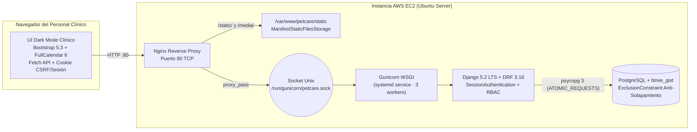

# 🐾 PetCare — Sistema de Gestión Clínica Veterinaria


**PetCare** es una plataforma web clínica y API REST empresarial diseñada para el personal interno de una clínica veterinaria (**Administrador**, **Veterinario** y **Recepcionista**). Centraliza la recepción de tutores y pacientes, el agendamiento con prevención estricta de solapamiento de horarios, la emisión de fichas clínicas digitales y el control preventivo de vacunas mediante un tablero semáforo en tiempo real.

---

## 🌐 Acceso para Revisión Docente (AWS EC2)

> [!IMPORTANT]
> **Datos de acceso directo a la instancia desplegada en AWS EC2:**
>
> - **IP Pública / URL de Producción:** `http://32.199.187.8/`
> - **Panel Administrativo Django:** `http://32.199.187.8/admin/`
> - **API Navegable DRF:** `http://32.199.187.8/api/`

### 🔐 Credenciales Predeterminadas por Rol

Todas las cuentas de evaluación se crean automáticamente al ejecutar `python manage.py seed_petcare` (incluido dentro de `deploy_ec2.sh`):

| Rol Interno | Usuario (`username`) | Nombre | Contraseña | Permisos Clave en el Sistema |
| :--- | :--- | :--- | :--- | :--- |
| **Administrador (`ADMIN`)** | `admin` | Rodrigo Castro | `PetCare2026!` | Acceso total al sistema, Django Admin, reportes, gestión de usuarios, borrado de agendas, fichas y vacunas. |
| **Veterinario (`VET`)** | `dr.munoz` | Egon Muñoz | `PetCare2026!` | Atención de citas asignadas, emisión/edición de `FichaClinica` y aplicación de `ControlVacuna`. |
| **Veterinario (`VET`)** | `dr.suazo` | Renato Suazo | `PetCare2026!` | Segundo veterinario activo para pruebas de filtrado y agenda paralela en FullCalendar. |
| **Recepcionista (`RECEP`)** | `recepcion` | Camila Fuentes | `PetCare2026!` | Gestión de `Tutor`, `Mascota` y agendamiento/confirmación de `Cita`. Lectura de fichas sin edición médica. |

---

## 🏗️ Arquitectura de la Solución



### Pilares Arquitectónicos

1. **Defensa en Profundidad Anti-Solapamiento (`Cita`)**:
   - **Capa 1 (Frontend)**: Pre-validación instantánea en el modal de FullCalendar al elegir veterinario, fecha y rango horario.
   - **Capa 2 (Serializador y Modelo)**: Validación en `CitaSerializer.validate()` y `Cita.clean()` con `Q(hora_inicio__lt=hora_fin) & Q(hora_fin__gt=hora_inicio) & ~Q(estado='CANCELADA')`.
   - **Capa 3 (Motor PostgreSQL)**: `ExclusionConstraint` GiST sobre `veterinario` (`=`) y `TSRANGE(fecha + hora_inicio, fecha + hora_fin, '[)')` (`&&`), impidiendo condiciones de carrera incluso con múltiples recepcionistas agendando en paralelo.
2. **Control de Acceso Basado en Roles (RBAC)**:
   - Implementado tanto en vistas tradicionales (`@personal_requerido`, `@clinico_requerido`) como en DRF (`EsPersonalClinica`, `LecturaPersonalEscrituraClinica`, `EsAdminOVeterinario`, `EsAutorFichaOAdmin`).
3. **Semáforo Inteligente de Vacunas (`ControlVacuna`)**:
   - Evalúa los controles vigentes descartando dosis históricas ya reemplazadas y los clasifica dinámicamente en **Vencidas (`< hoy`)**, **Críticas (`próximos 7 días`)** y **Al Día (`> hoy + 7 días`)**.

---

## 📂 Estructura del Proyecto

```text
petcare/
├── config/                     # Núcleo de configuración Django (settings, urls, wsgi, asgi)
├── usuarios/                   # Modelo Usuario (AbstractUser con roles ADMIN, VET, RECEP) y permisos
├── clinica/                    # Dominio clínico (Tutor, Mascota, Cita, FichaClinica, ControlVacuna)
│   ├── management/commands/    # Comando `seed_petcare` con usuarios y datos iniciales
│   ├── migrations/             # Migraciones con extensión PostgreSQL `BtreeGistExtension`
│   ├── admin.py                # Panel administrativo empresarial con badges e inlines
│   ├── models.py               # Modelos del dominio, validadores y restricciones GiST/Check
│   ├── serializers.py          # Serializadores DRF y contrato nativo de FullCalendar 6
│   ├── services.py             # Reglas de negocio desacopladas de HTTP
│   ├── urls.py                 # Rutas web y endpoints REST (/api/...)
│   └── views.py                # ViewSets DRF y vistas tradicionales Django
├── templates/                  # Interfaz "Dark Mode Clínico" (Bootstrap 5.3 + FullCalendar 6)
│   ├── base.html               # Sidebar colapsable, tarjeta de trabajador, reloj vivo
│   ├── login.html              # Acceso por sesión con botones de prueba docente
│   ├── dashboard.html          # 4 KPIs luminosos + agenda inmediata del día
│   ├── tutores_mascotas.html   # Buscador en tiempo real + modales Fetch sin recarga
│   ├── calendario_citas.html   # FullCalendar 6 con selector de veterinario y alerta de choque
│   ├── ficha_clinica.html      # Timeline vertical de historial + formulario por pestañas
│   └── recordatorios.html      # Tablero Kanban semáforo de 3 columnas
├── static/                     # Hoja de estilos `petcare-dark.css` y cliente `petcare.js`
├── deploy_ec2.sh               # Script Bash no interactivo de despliegue en AWS EC2
├── prompts_ia.md               # Bitácora académica del uso de IA en las 5 etapas
├── requirements.txt            # Dependencias fijadas para producción
└── .env.example                # Plantilla de variables de entorno
```

---

## 🛠️ Manual de Ejecución Paso a Paso

### Opción A: Ejecución en Entorno Local (Desarrollo)

#### 1. Clonar el repositorio y crear el entorno virtual
```bash
git clone https://github.com/Rodryxb/petcare.git
cd petcare
python -m venv .venv
```

- **En Windows (PowerShell):**
  ```powershell
  .\.venv\Scripts\Activate.ps1
  pip install -r requirements.txt
  ```
- **En Linux / macOS:**
  ```bash
  source .venv/bin/activate
  pip install -r requirements.txt
  ```

#### 2. Configurar PostgreSQL y el archivo `.env`
Cree la base de datos y habilite la extensión `btree_gist` en PostgreSQL:
```sql
CREATE USER petcare_user WITH PASSWORD 'cambia-esta-password';
CREATE DATABASE petcare OWNER petcare_user;
\c petcare
CREATE EXTENSION IF NOT EXISTS btree_gist;
```

Copie el archivo `.env.example` a `.env` y ajuste sus credenciales locales:
```bash
cp .env.example .env
```

#### 3. Ejecutar migraciones, cargar datos de prueba e iniciar el servidor
```bash
python manage.py migrate
python manage.py seed_petcare
python manage.py runserver
```
Acceda en su navegador a `http://127.0.0.1:8000/`.

---

### Opción B: Despliegue Automatizado en la Nube (AWS EC2 — Ubuntu Server)

1. **Lanzar una instancia EC2** con **Ubuntu Server 22.04 LTS o 24.04 LTS** y habilitar en su *Security Group* los puertos **22 (SSH)** y **80 (HTTP)**.
2. **Conectarse por SSH y clonar el proyecto**:
   ```bash
   ssh -i "tu-llave.pem" ubuntu@<IP_PUBLICA_EC2>
   git clone https://github.com/Rodryxb/petcare.git petcare
   cd petcare
   ```
3. **Ejecutar el script de despliegue desatendido**:
   ```bash
   chmod +x deploy_ec2.sh
   sudo ./deploy_ec2.sh
   ```
4. **Verificar el estado de los servicios**:
   ```bash
   sudo systemctl status gunicorn
   sudo systemctl status nginx
   ```

---

## 🔌 Resumen de Endpoints REST (`/api/`)

| Método | Endpoint | Permiso Requerido | Descripción |
| :--- | :--- | :--- | :--- |
| `GET/POST` | `/api/tutores/?q=` | `ADMIN`, `VET`, `RECEP` | Listado con buscador por RUT/apellido y alta de tutores. |
| `GET/PATCH` | `/api/tutores/{id}/` | `ADMIN`, `VET`, `RECEP` | Detalle y edición de un tutor. |
| `GET/POST` | `/api/mascotas/?q=` | `ADMIN`, `VET`, `RECEP` | Listado filtrado y registro de mascotas. |
| `GET/POST` | `/api/citas/` | `ADMIN`, `VET`, `RECEP` | Creación de citas con validación anti-solapamiento. |
| `GET` | `/api/citas/calendario/?veterinario_id=X` | `ADMIN`, `VET`, `RECEP` | Eventos en formato FullCalendar (`id`, `title`, `start`, `end`, `color`, `extendedProps`). |
| `POST` | `/api/citas/{id}/cambiar-estado/` | `ADMIN`, `VET`, `RECEP`* | Transición de estado (*`EN_ATENCION` y `FINALIZADA` exigen `VET` o `ADMIN`). |
| `GET/POST` | `/api/fichas-clinicas/` | Lectura: Todos · Escritura: `VET`, `ADMIN` | Emisión de ficha clínica, actualización de peso y cierre de cita. |
| `GET` | `/api/controles-vacunas/recordatorios/` | `ADMIN`, `VET`, `RECEP` | Clasificación en `vencidas`, `criticas` (7 días) y `al_dia`. |
| `POST` | `/api/controles-vacunas/{id}/aplicar/` | Exclusivo `VET`, `ADMIN` | Marca una vacuna como aplicada hoy y calcula próximo vencimiento. |
